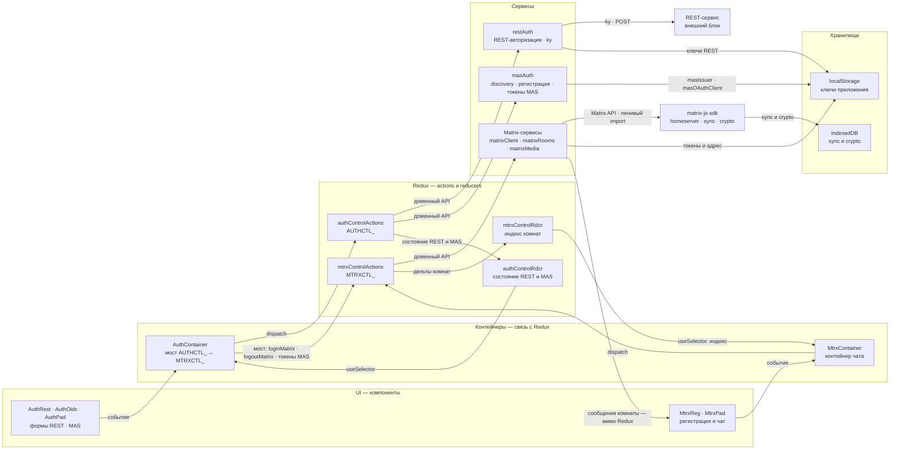
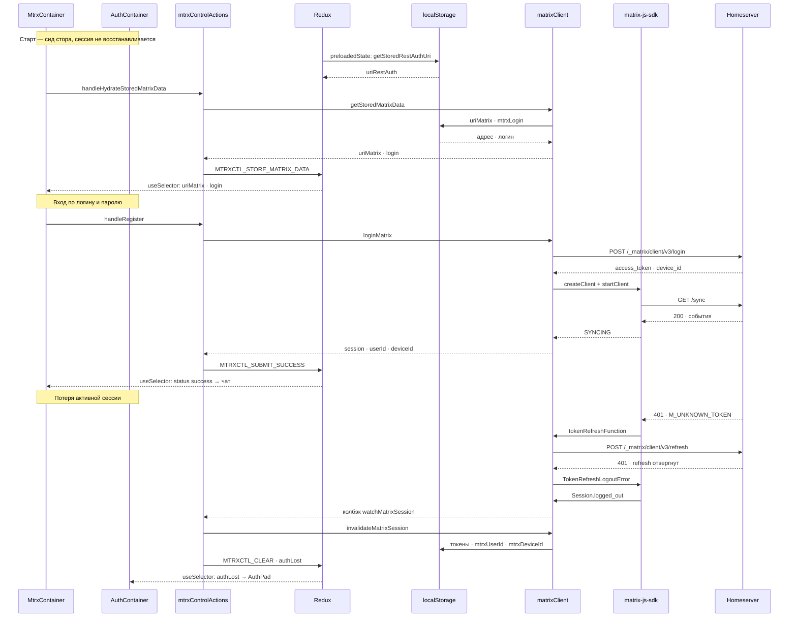
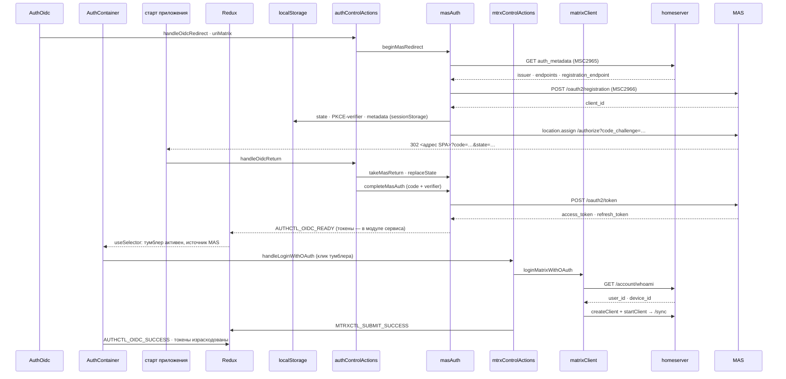
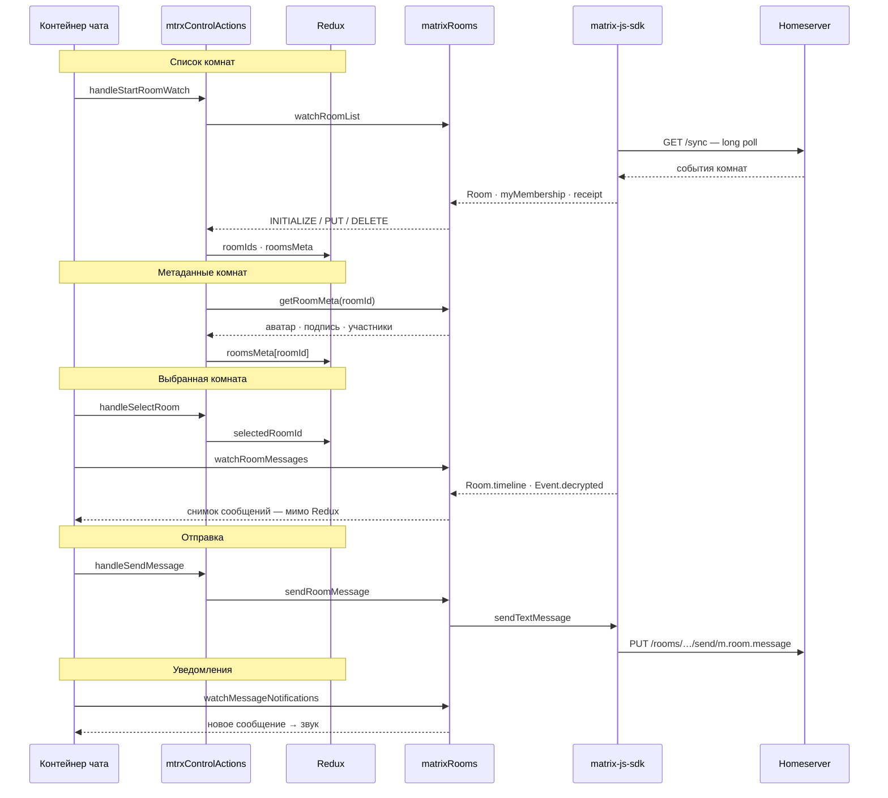
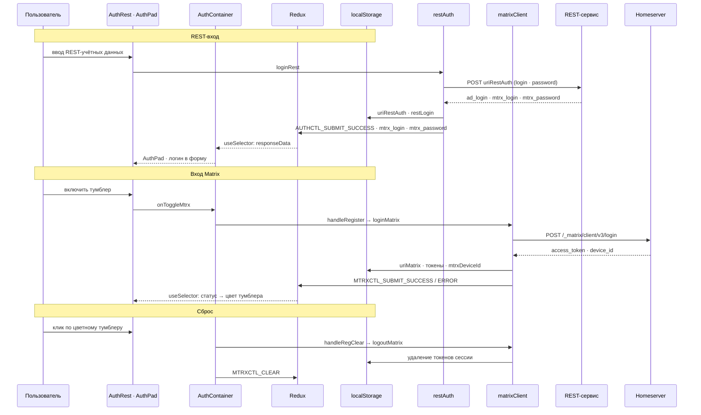
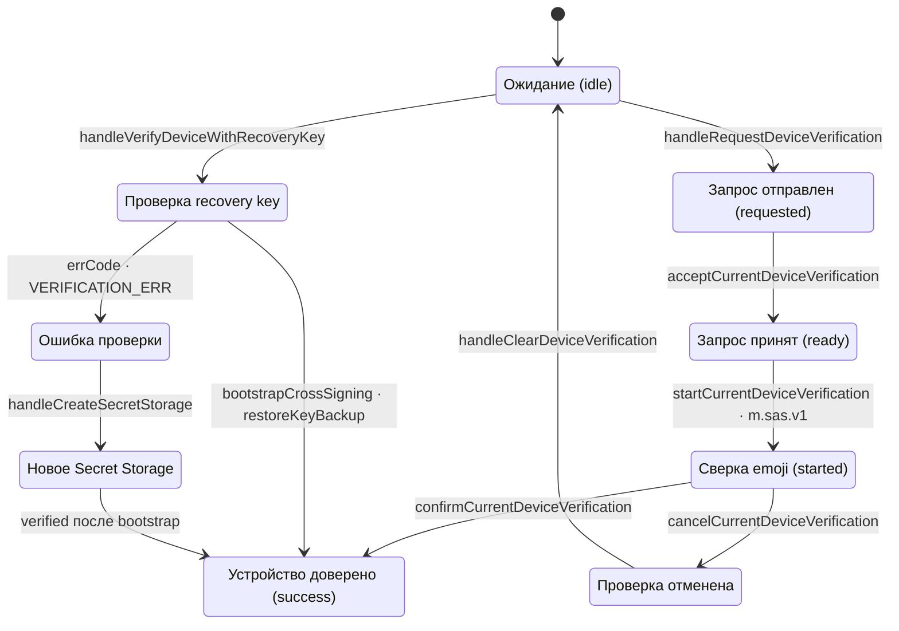

# Архитектура matrix-react

**Правило документации: archify первичен.** Источник истины — интерактивные диаграммы в
[`docs/archify/`](archify/) (JSON-спецификация + собранный HTML). Mermaid-блоки ниже — только
короткий повтор первичной диаграммы (её сообщений и карточек) с комментариями по ключевым
моментам: новых фактов и более подробных потоков в них не появляется. Нужен новый факт — сначала правь archify-спеку и
пересобирай HTML (§ 7), потом повторяй здесь. Полный свод правил проекта — в
[AGENTS.md](../AGENTS.md).

## 1. Архитектура

[Диаграмма](archify/matrix-react-architecture.html) · спека
`archify/matrix-react-architecture.architecture.json`.



- Пунктирные области — слои: UI, контейнеры (связь со store), Redux (`actions` и `reducers`),
  сервисы и хранилище; `REST-сервис` и `matrix-js-sdk` — внешние блоки вне слоёв.
- Срезы `AUTHCTL_` и `MTRXCTL_` идут строками (суффикс в подписях узлов): состояние каждого —
  свой редьюсер (`authControlRdcr`, `mtrxControlRdcr`), а переход между срезами есть только в
  `AuthContainer` (мост); обратный поток (`authLost`, `mtrx_user_id`) идёт через тот же мост.
- У каждого среза свой сервис и внешний ресурс: `AUTHCTL_` → `restAuth` (REST-сервис · `ky`) и
  `masAuth` (discovery MAS, регистрация, PKCE и токены), `MTRXCTL_` → Matrix-сервисы →
  `matrix-js-sdk`. AUTH-слой больше не строит SSO-редирект Synapse: MAS — самостоятельный
  OAuth-провайдер, а `masAuth` использует `OAuth2`/`getAuthMetadata` из SDK. Ключи приложения в
  `localStorage` пишут сервисы обоих срезов, sync и crypto — в `IndexedDB`.
- Thunk-и namespace-чистые: `AUTHCTL_` и `MTRXCTL_` не диспатчат чужой срез — мост между ними
  только в `AuthContainer`.
- `matrix-js-sdk` грузится лениво: `import()` в `services/matrixSdk.js` даёт отдельный чанк
  `matrix-sdk`, активный клиент держит `services/matrixClientStore.js`; UI и Redux видят только
  доменный API сервисов, без SDK-объектов.
- Сервисов авторизации два: `restAuth` (REST-сессия и матричная пара) и `masAuth` (вход через
  MAS, см. § 2). OIDC — вход, общий для приложения, поэтому его форма и issuer (`oidcIssuer`)
  живут в срезе `AUTHCTL_`; узел `masAuth` на диаграмме архитектуры связан с `authAct` и
  `localStorage`, а зависимость от `OAuth2`/`getAuthMetadata` SDK описана в § 2.

## 2. Старт и авторизация

[Диаграмма](archify/matrix-react-session-restore.html) · спека
`archify/matrix-react-session-restore.sequence.json`.



- Старт: сохранённые адрес и логин только предзаполняют форму входа; клиент Matrix не создаётся,
  `status` остаётся `idle`, поэтому виден `AuthLinks` — авторизация требуется при каждом запуске.
- Самый ранний доступ к хранилищу — ещё до монтирования React: сид стора
  (`store/preloadedState.js`) читает `uriRestAuth` через `restAuth.getStoredRestAuthUri`.
- Состояние ведёт срез `mtrxControlRdcr`: гидратация (`MTRXCTL_STORE_MATRIX_DATA`), вход
  (`MTRXCTL_SUBMIT_SUCCESS`) и потеря сессии (`MTRXCTL_CLEAR · authLost`) приходят dispatch'ем,
  а `MtrxContainer` и `AuthContainer` читают их через `useSelector` — прямых стрелок от действий
  к UI в коде нет.
- Вход: `loginMatrix` делает `loginRequest` (POST `/login`, `refresh_token: true`), затем
  `createMatrixClientFromSession` (`createClient` с IndexedDB, crypto и `tokenRefreshFunction`) и
  `startMatrixSync`; `SYNCING` даёт снимок сессии, `status success` включает чат и
  `handleStartRoomWatch`.
- Сохранённый access token для входа не используется: токены нужны активной сессии и
  переиспользованию `deviceId` при следующем входе тем же логином (важно для E2EE).
- Потеря активной сессии (карточка «Потеря активной сессии»): 401 (`M_UNKNOWN_TOKEN`) зовёт
  `tokenRefreshFunction`; принятый refresh обновляет токены без сброса, а 401 на refresh —
  `TokenRefreshLogoutError` → `Session.logged_out` → колбэк `watchMatrixSession` →
  `invalidateMatrixSession` (токены и IndexedDB удалены) → `authLost` → `AuthPad` с красным
  тумблером.

### Вход через MAS (OIDC)

[Диаграмма](archify/matrix-react-oidc-login.html) · спека
`archify/matrix-react-oidc-login.sequence.json`. Ветка отдельная от диаграммы § 2: она не
восстанавливает сессию, а добывает OAuth-токены полностраничным переходом в MAS и поднимает
сессию по клику тумблера. Discovery, регистрацию клиента, PKCE и обмен кода ведёт AUTH-срез
(`services/masAuth.js`, thunk-и `handleOidcRedirect` / `handleOidcReturn`, namespace `AUTHCTL_`),
сессию Matrix по токенам поднимает `handleLoginWithOAuth` (`MTRXCTL_`), а шаги связывает мост
`AuthContainer`:



- Форма `AuthOidc` (модальный `Dialog`) больше не собирает адрес IdP: в ней одна кнопка и
  подпись с issuer, который приходит из discovery. Сервер авторизации и его endpoints задаёт
  `GET /auth_metadata` homeserver (MSC2965; SDK выбирает стабильный `/v1` или unstable-префикс
  по `/versions`); на сервере с MAS это `https://mas.ars-dev.ru/`, а `.well-known/matrix/client`
  дополнительно отдаёт `m.authentication.issuer`.
- Вход ведёт `AUTHCTL_`: `handleOidcRedirect` запускает `beginMasRedirect` — discovery,
  динамическую регистрацию public-клиента (MSC2966; client_id кэшируется и регистрация
  повторяется только при смене issuer/redirect URI) и Authorization Code + PKCE. State,
  PKCE-verifier, device_id и метаданные перехода сохраняются в `sessionStorage` **до** редиректа:
  на возврате память страницы уже новая. Issuer и client_id кэшируются в `localStorage`.
- `handleOidcReturn` разбирает `?code&state` до первой отрисовки, сразу чистит адресную строку
  через `history.replaceState` и меняет код на токены в `token_endpoint` (`completeMasAuth`).
  Токены в стор не попадают — они лежат в модуле `services/masAuth.js` (DEV-логгер печатает
  payload'ы экшенов), а готовность источника видна по `oidcStatus`.
- Matrix-сессию по токенам поднимает `MTRXCTL_` (`handleLoginWithOAuth`) — но не автоматически, а
  по клику тумблера `AuthPad`: запуск сервиса всегда идёт через мост, а источник (пара REST или
  токены MAS) выбирается в панели явно. `loginMatrixWithOAuth` проверяет access token через
  `whoami`, получает `user_id` и `device_id`, а `activateMatrixSession` создаёт клиент и запускает
  sync. Успех и ошибку подъёма мост возвращает в `AUTHCTL_`.
- Access token MAS — обычный Matrix-токен: Synapse проверяет его через introspection. Поэтому
  `POST /login` с `m.login.token` и `loginToken` больше не используются; `AUTHCTL_OIDC_SUCCESS`
  только помечает токены израсходованными, чтобы повторно ими сессию не поднять.
- Refresh OAuth-сессии идёт на `token_endpoint` MAS (`refresh_token` grant), а не на compat-эндпоинт
  `/_matrix/client/v3/refresh`. Ошибка `invalid_grant`/400/401 на refresh превращается в
  `TokenRefreshLogoutError` и красный тумблер; сетевая ошибка оставляет сессию и повторяется SDK.
- Выход завершает OAuth-сессию отзывом access и refresh токенов на `revocation_endpoint` MAS:
  compat-эндпоинт `/logout` рассчитан на compat-токены и OAuth-сессию не закрывает.
- Почему не legacy-схема Synapse `m.login.sso`: на сервере с MAS возврат `redirectUrl` ограничен
  известными клиентами (в nginx — `cinny.ars-dev.ru`), а MAS сам является OAuth-провайдером.
  Прямой discovery + PKCE не требует client secret и работает для SPA на любом разрешённом
  redirect URI.

## 3. Чат

[Диаграмма](archify/matrix-react-chat-flow.html) · спека
`archify/matrix-react-chat-flow.sequence.json`.



- Граница Redux: список комнат и выбор — лёгкий индекс (`roomIds`, `selectedRoomId`, `roomsMeta`),
  который обновляется дельтами; сообщения активной комнаты остаются в SDK.
- Две подписки: `watchRoomList` обновляет индекс, `watchRoomMessages` отдаёт таймлайн
  контейнеру напрямую (в том числе по `Event.decrypted`) — сообщения активной комнаты не проходят
  через Redux.
- После каждой дельты действия догружают метаданные комнаты (`getRoomMeta` → `roomsMeta`); они
  приходят асинхронно и не блокируют список.
- Сигнал о новом сообщении даёт сервис (`watchMessageNotifications`), а решение играть звук
  принимает UI — ему нужны фокус окна и видимость комнаты.
- `localStorage` в этом потоке не участвует: `matrixRooms` и `matrixMedia` хранилище не трогают,
  комнаты и сообщения живут в SDK, а индекс — в `mtrxControlRdcr` (поэтому участника
  `localStorage` на диаграмме нет).
- Homeserver участвует через SDK: список и таймлайн приходят из `/sync`, отправка уходит
  `PUT /rooms/…/send/m.room.message`; аватары и медиа — тоже запросы к Homeserver.

## 4. Мост Auth → Чат

[Диаграмма](archify/matrix-react-auth-sequence.html) · спека
`archify/matrix-react-auth-sequence.sequence.json`.



- `AuthContainer` — единственный мост между срезами `AUTHCTL_` и `MTRXCTL_` (реквизиты REST,
  тумблер и OAuth-токены MAS); пароль REST в Matrix Redux не попадает.
- Оба среза сходятся в Redux: `authControlRdcr` принимает `AUTHCTL_SUBMIT_SUCCESS`,
  `mtrxControlRdcr` — `MTRXCTL_SUBMIT_SUCCESS / ERROR` и `MTRXCTL_CLEAR`; цвета тумблера и
  реквизиты REST мост читает из них через `useSelector`.
- Отключённый тумблер запускает вход данными REST или OAuth-токенами MAS; успех, ошибка или
  потеря сессии — сброс.
- Внешние серверы показаны явно: `restAuth` ходит в REST-сервис (`POST uriRestAuth`), `matrixClient` —
  на Homeserver (`POST /login` для пароля либо `GET /account/whoami` для токена MAS, дальше `/sync`
  через `createClient + startClient`).
- Ключи REST и Matrix ложатся в `localStorage` (`constants/storage.js`); при сбросе токены
  удаляются, адрес и логин остаются, а вместе с токенами чистятся IndexedDB-хранилища `sync` и
  `crypto`.

## 5. E2EE: авторизация устройства

[Диаграмма](archify/matrix-react-device-verification.html) · спека
`archify/matrix-react-device-verification.lifecycle.json`.



- Основной путь: `handleRequestDeviceVerification` ставит `loading`, `requestCurrentDeviceVerification`
  даёт фазу `requested`, `acceptCurrentDeviceVerification` — `ready`,
  `startCurrentDeviceVerification` запускает `m.sas.v1` и показывает emoji;
  `confirmCurrentDeviceVerification` подтверждает SAS, а `verified` приходит с задержкой —
  подпись устройства доезжает crypto-событиями уже после SAS.
- Recovery key: `verifyCurrentDeviceWithRecoveryKey` декодирует ключ, ждёт первый `/sync` и
  сверяет его через `checkKey`; `createNewSecretStorage` создаётся по подтверждению и показывает
  новый `recoveryKey`, а `resetOwnEncryption` по паролю аккаунта делает новую кросс-подпись,
  Secret Storage и ключ.
- Коды `constants/verification.js` выбирают подсказку и следующий шаг: `NO_SECRET_STORAGE` —
  создать хранилище секретов, `CROSS_SIGNING_MISSING` / `RESET_FAILED` — сброс E2EE или запрос с
  другого устройства, `SYNC_INCOMPLETE` — «Повторить», остальные — ввести другой ключ.
- Новый recovery key показывается до конца сессии (`deviceVerification.recoveryKey` в Redux) и в
  `localStorage` не пишется.

## 6. Хранилища

`localStorage` доступен только сервисам; ключи объявлены в `src/constants/storage.js`.
Стартовые адреса `uriMatrix` и `uriRestAuth` прописывает inline-скрипт `index.html` — до загрузки
приложения; дальше эти ключи читают и пишут только сервисы. Адрес MAS в `index.html` не задаётся:
issuer и endpoints приходят из auth_metadata homeserver.
`matrixClient` хранит `uriMatrix`, `mtrxLogin`, `mtrxAccessToken`, `mtrxUserId`, `mtrxDeviceId` и
`mtrxRefreshToken`; `restAuth` — `uriRestAuth` и `restLogin`; `masAuth` — `masIssuer` (issuer для
подписи источника) и `masOAuthClient` (зарегистрированный client_id и redirect_uri).
Токены нужны активной сессии и переиспользованию `deviceId`, а не для входа при следующем
запуске. При выходе удаляются токены, `mtrxUserId` и `mtrxDeviceId`; recovery key и ключ Secret
Storage живут только в памяти сессии. Вместе с токенами `matrixClient` чистит IndexedDB-хранилища
SDK (`sync` и `crypto`). `IndexedDB` принадлежит `matrix-js-sdk`; в `localStorage` он пишет свои
служебные ключи (например, id фильтра sync), а очередь неотправленных событий попадает туда только
при `pendingEventOrdering: Detached`, который приложение не задаёт.

Отдельно от `localStorage`: токены MAS до клика тумблера живут в модуле `services/masAuth.js`, а
`sessionStorage` (`masOauthPending`) хранит state, PKCE-verifier, device_id и метаданные
незавершённого перехода — по нему приложение завершает обмен кода и показывает «вход не
завершён» после страницы ошибки MAS. `masOAuthClient` и `masIssuer` переживают выход: повторный
вход не регистрирует нового клиента.

## 7. Документация archify: первичный источник

Диаграммы собираются навыком `archify`, отрисовка проверяется навыком `archify-visual-check`
(оба — плагин профиля `web`); готовые HTML и JSON руками не правятся.

```bash
ARCHIFY="$HOME/.dsh/profiles/web/node_modules/@tt-a1i/archify-dsh/skills/archify/bin/archify.mjs"

# 1. Приёмка спеки: 9/9 проверок, composition 0 ошибок / 0 предупреждений
node "$ARCHIFY" validate architecture docs/archify/<name>.architecture.json \
  --quality showcase --repo-root . --json

# 2. Сборка: единственная пишущая команда, печатает SHA-256 и байты спеки и артефакта
node "$ARCHIFY" deliver architecture docs/archify/<name>.architecture.json \
  docs/archify/<name>.html --quality showcase --repo-root . --json

# 3. Визуальный контроль: containment и light/dark скриншоты, HTML не меняет
node "$ARCHIFY" visual-check docs/archify/<name>.html --json
```

- Профиль качества — `showcase`; для sequence меняется только тип (`validate sequence`), а
  `--repo-root .` не нужен: поле `meta.repository` есть только у architecture.
- Раскладка артефактов: `<name>.<type>.json` (спека) + `<name>.html` (артефакт) +
  `<name>.visual-check.*` (receipt, скриншоты, contact sheet).
- `visual-check` всегда пишет `visualReview: "pending"`: скриншоты — материал для глаза, а не
  автоматическое подтверждение отрисовки; визуальную приёмку делает навык
  `archify-visual-check`.
- Порядок участников sequence — по [AGENTS.md](../AGENTS.md) п. 4: React-компоненты (`frontend`)
  слева, `localStorage` и reducer рядом, runtime-сервис перед внешними, внешние сервисы
  (`external`) — крайними справа; инициатор-человек остаётся первым.
- Подписи в артефактах — по-русски, как и в этом файле; имена продуктов, команд и API остаются
  английскими.
